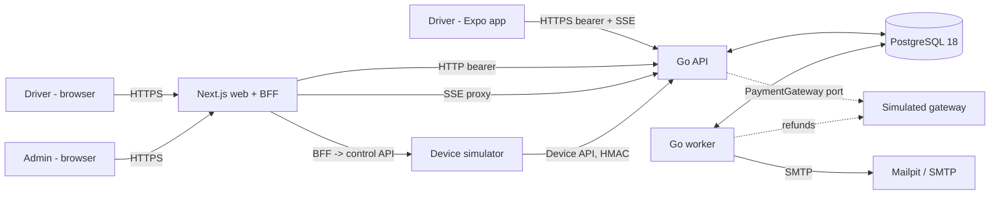
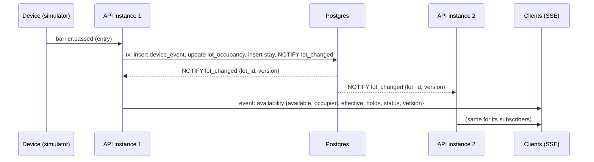

# MyPark — Architecture

MyPark has three apps: a **Go API**, a **Next.js web** app and an **Expo mobile** app. They sit on **one PostgreSQL database**, with a Go **worker** for background jobs and a Go **device simulator**. The core design goals:

- the gate count is the single source of truth for occupancy;
- the reservation cap is enforced atomically in the database;
- devices and the payment gateway sit behind ports, so simulated adapters can be swapped for real ones without touching domain code.

> Requirements live in [`spec.md`](./spec.md) (FR-/NFR- IDs referenced below). Rules for contributors live in [`policies.md`](./policies.md). Decisions not made explicitly by the product owner are tagged **(our call)**.

---

## 1. Decisions at a glance

| Area | Decision |
|---|---|
| Repo | Monorepo `github.com/XYZLZ/MyPark`. npm workspaces for JS (`apps/web`, `apps/mobile`, `packages/contracts`). Go module `github.com/XYZLZ/MyPark/apps/server` (not part of the workspaces) |
| Branding | Banreservas name, logo and colors (deep blue + orange accent), shown as "MyPark · Banreservas Zona Colonial". Brand tokens are placeholders (`TODO(brand)`) until official assets arrive |
| Backend | Go 1.27, stdlib `net/http` ServeMux routing, `pgx/v5` pool, `sqlc`, `goose` migrations, `slog` |
| Backend style | Feature-sliced hexagonal: `internal/features/<feature>` owns domain + ports + use cases. Adapters live in `postgres/` subpackages and `internal/infrastructure` |
| Database | PostgreSQL 18 (built-in `uuidv7()`), plain Postgres, no Supabase services **(our call: version)** |
| Auth | Go-owned. argon2id passwords, 15-min JWT access tokens, rotating opaque refresh tokens with reuse detection |
| Web sessions | Next.js **BFF**: route handlers hold tokens in httpOnly cookies, and the browser never sees a token **(our call)** |
| Mobile sessions | Bearer access token in memory + refresh token in `expo-secure-store` |
| Real time | SSE from Go, fanned out across instances with Postgres `LISTEN/NOTIFY` **(our call)** |
| Background jobs | `cmd/worker`: scheduled scans with `FOR UPDATE SKIP LOCKED` plus a transactional outbox |
| Devices | Device API with per-device HMAC-SHA256 signatures, idempotency by event id, and a replay window |
| Payments | `PaymentGateway` port (Charge/Refund, idempotent). Phase 1 uses a `simulated` adapter |
| Web | Next.js 16.4 + React 19.3.0 + Tailwind 4.3, next-intl, TanStack Query, zustand, zod, vitest, Playwright |
| Mobile | Expo SDK 58 (RN 0.88.1, React 19.3.0), expo-router, Uniwind 1.13, i18next + expo-localization, TanStack Query, zustand, zod, jest-expo |
| JS toolchain | TypeScript 6.0.3 (Expo SDK 58 pin) and eslint 9.39.5 in every workspace. A scoped root override `{"openapi-typescript":{"typescript":"6.0.3"}}` satisfies openapi-typescript's peer range. `npm install <pkg>` fails with ERESOLVE, so add a dependency by editing `package.json`, then run `npm install` |
| Contracts | OpenAPI 3.1 written in `apps/server/api/openapi.yaml`, TS types generated into `packages/contracts` **(our call)** |
| Deploy | Docker Compose locally. VPS-ready: same images + Caddy TLS edge (Phase 2) |

---

## 2. System context



### 2.1 Containers

| Container | Image / runtime | Responsibility | Port (dev) |
|---|---|---|---|
| `api` | `apps/server` → `cmd/api` | REST `/v1`, SSE, device API, auth | 8080 |
| `worker` | `apps/server` → `cmd/worker` | Expiries, snapshots, outbox email, refunds, reconciliation | — (health 8091; 8081 is Metro's) |
| `simulator` | `apps/server` → `cmd/simulator` | Simulated devices + control API | 8090 (published on 127.0.0.1 for dev) |
| `web` | `apps/web` | Public, driver and admin UIs; BFF route handlers | 3000 |
| `postgres` | `postgres:18` | System of record + LISTEN/NOTIFY | 5432 |
| `mailpit` | `axllent/mailpit` | Dev SMTP sink + UI | 1025 / 8025 |
| mobile | Expo on the host machine | Driver app (dev client / Expo Go, EAS preview APK) | — |

`cmd/migrate` and `cmd/seed` are one-shot compose services that run on every `up`, with no profile. Start order: `postgres` → `migrate` → `seed` → `api` / `worker` → `web`.

Every published port binds to `127.0.0.1` except the `api`, which listens on all interfaces so Expo on a LAN device can reach it.

---

## 3. Repository layout

```
MyPark/
├─ apps/
│  ├─ server/                     # Go module: github.com/XYZLZ/MyPark/apps/server
│  │  ├─ api/openapi.yaml         # Source of truth for HTTP contract
│  │  ├─ cmd/{api,worker,migrate,simulator,seed}/
│  │  ├─ internal/
│  │  │  ├─ config/               # env → typed config, validated at boot
│  │  │  ├─ domain/               # shared kernel: Money, Clock, IDs, errors
│  │  │  ├─ features/
│  │  │  │  ├─ auth/  {.., postgres/}
│  │  │  │  ├─ users/ {.., postgres/}
│  │  │  │  ├─ vehicles/ {.., postgres/}
│  │  │  │  ├─ lots/ {.., postgres/}          # lot, spaces, settings
│  │  │  │  ├─ availability/ {.., postgres/}  # counter, SSE feed
│  │  │  │  ├─ reservations/ {.., postgres/}
│  │  │  │  ├─ payments/ {.., postgres/}
│  │  │  │  ├─ tariffs/ {.., postgres/}       # versioned tariffs + policies
│  │  │  │  ├─ gate/ {.., postgres/}          # device events, stays, tickets
│  │  │  │  ├─ devices/ {.., postgres/}
│  │  │  │  ├─ employeecards/ {.., postgres/}
│  │  │  │  ├─ analytics/ {.., postgres/}
│  │  │  │  ├─ reconciliation/ {.., postgres/}
│  │  │  │  ├─ notifications/ {.., postgres/} # outbox
│  │  │  │  ├─ audit/ {.., postgres/}
│  │  │  │  └─ health/
│  │  │  ├─ infrastructure/
│  │  │  │  ├─ database/{migrations/,queries/,sqlc.yaml}
│  │  │  │  ├─ validation/        # go-playground/validator wrapper
│  │  │  │  ├─ jwt/  hashing/  secretbox/  email/  ratelimit/
│  │  │  │  ├─ payment/{simulated/}
│  │  │  │  ├─ pubsub/            # LISTEN/NOTIFY hub
│  │  │  │  └─ clock/
│  │  │  ├─ simulator/            # scenario engine (used by cmd/simulator)
│  │  │  ├─ transport/http/{healthprobe/,httpserver/,middleware/,response/,sse/,devicesig/}
│  │  │  └─ testsupport/          # pg test DB, fixtures, fake clock
│  │  ├─ Dockerfile  go.mod  go.sum
│  ├─ web/                        # Next.js (layout mirrors cognifield apps/client)
│  │  └─ src/{app,components,design,features,hooks,lib,i18n,testing}
│  └─ mobile/                     # Expo (layout mirrors nexVial-app)
│     └─ src/{app,components,constants,design,features,hooks,lib,services,store,types}
├─ packages/contracts/            # generated API types + error-code catalog
├─ deploy/{compose/{docker-compose.yml,postgres/init/01-roles.sh}, edge/Caddyfile (Phase 2)}
├─ docs/{spec.md,architecture.md,policies.md}
├─ scripts/{check-single-react.mjs,check-i18n-parity.mjs}
├─ .github/workflows/{ci-server.yml (job server), ci-js.yml (jobs contracts, web, mobile)}
└─ package.json                   # npm workspaces, root scripts
```

---

## 4. Backend architecture (Go)

### 4.1 Layers inside a feature

```
transport/http handler ──► use case (service) ──► port (interface)
                                 │                     ▲
                              domain types          adapter (postgres/, payment/simulated, ...)
```

| Layer | Contains | May import |
|---|---|---|
| Domain (`features/x/*.go`) | Entities, value objects, state machines, pure rules (fee calculation, availability formula) | `internal/domain` only. No `pgx`, no `net/http` |
| Use cases (`features/x/service.go`) | Orchestration, transactions via a `TxRunner` port, authorization checks | domain, ports |
| Ports (`features/x/ports.go`) | `Repository`, `PaymentGateway`, `Notifier`, `Clock`, `Publisher` interfaces | domain |
| Adapters (`features/x/postgres`, `infrastructure/*`) | sqlc queries, SMTP, gateway, pubsub | anything |
| Transport (`transport/http`, feature `http.go`) | Decode/validate → call use case → encode envelope | use cases |

Rules: dependencies point inward; composition happens only in `cmd/*/main.go`; features call each other through **exported use-case interfaces**, never through another feature's repository; time comes from `Clock` so tests can control it.

### 4.2 HTTP

- Go 1.22+ `ServeMux` method+path patterns (`POST /v1/reservations`) **(our call: no third-party router)**.
- Global middleware chain (every route, OC-2): recover → request ID → slog access log → secure headers → CORS (exact-match allow-list from `CORS_ALLOWED_ORIGINS`, answers preflights itself) → JSON 404/405 router. Recover drops stale response headers and re-applies `X-Request-Id` and the security headers before writing the 500 envelope. The access log runs in a `defer` (so panicked requests are logged with `panicked=true`) and adds `user_id` when a handler sets it.
- Per-route wrappers, added where a route needs them: client IP (`middleware.ClientIP`, trusts `X-Forwarded-For` only from trusted proxy CIDRs and reads the rightmost untrusted hop), rate limit, auth (bearer), handler.
- Connection parameters (values in the URL win):
  - App pool: `statement_timeout=5s`, `application_name=mypark`.
  - Migrator: `lock_timeout=10s`, `application_name=mypark-migrate`, no `statement_timeout`.
- The request context sets the deadline.

### 4.3 Error envelope (stable codes for i18n)

Every response uses one baseline envelope (decided 2026-11-07, see the M1 backend design §6.0). Success is `{ "data": …, "meta": { "request_id" } }`, lists add `meta.page` `{limit, next_cursor}`, and `204` has no body. Errors look like this:

```json
{ "error": { "code": "reservation.capacity_reached", "message": "debug-only english text",
             "details": { "field": "arrival_at" } },
  "meta":  { "request_id": "01J..." } }
```

- `code` is `<domain>.<reason>` in snake_case and is the **contract**. Clients translate the code and never show `message` to end users.
- The code catalog lives in `apps/server/internal/domain/errcodes/errcodes.go`. It is exported to `packages/contracts/src/error-codes.ts` by `go generate`, and CI fails on drift.
- Input validation failures return `validation.failed` (422) with `details.fields[{field, rule, param}]`.
- Unknown routes and wrong methods return JSON envelopes too: `http.not_found` (404) and `http.method_not_allowed` (405).
- HTTP status mapping: validation 422, auth 401, forbidden 403, not found 404, conflict/state 409, rate limit 429.

### 4.4 API surface (v1 overview)

| Group | Endpoints (abridged) | Auth |
|---|---|---|
| Auth | `POST /v1/auth/register`, `/verify`, `/verify/resend`, `/login`, `/refresh`, `/logout`, `/logout-all`, `/password/forgot`, `/password/reset`, `/invitations/accept` | public / bearer |
| Legal | `GET /v1/legal/current` (current terms + privacy versions); `register` requires `accepted_terms_version` + `accepted_privacy_version`; `POST /v1/me/legal-acceptance` re-accepts after a version bump | public / driver |
| Me | `GET/PATCH /v1/me`, `DELETE /v1/me` (password re-check, rate limited 5 per 15 min per user) | driver (`GET` also admin) |
| Vehicles | `GET/POST /v1/vehicles`, `GET/PATCH/DELETE /v1/vehicles/{id}` | driver |
| Lot (public) | `GET /v1/lots/{id}`, `GET /v1/lots/{id}/availability`, `GET /v1/lots/{id}/availability/stream` (SSE), `GET /v1/lots/{id}/tariff` | public |
| Reservations | `POST /v1/reservations/quote`, `POST /v1/reservations`, `GET /v1/reservations`, `GET /v1/reservations/{id}`, `PATCH /v1/reservations/{id}` (change vehicle until arrival), `POST /v1/reservations/{id}/pay`, `POST /v1/reservations/{id}/cancel`, `GET /v1/reservations/{id}/qr` | driver |
| Payments | `GET /v1/payments`, `GET /v1/payments/{id}` | driver |
| Device API | `POST /v1/devices/events` (single endpoint, typed events), `POST /v1/devices/heartbeat` | device HMAC |
| Admin | `/v1/admin/{dashboard,stream,reservations,stays,tariffs,policies,lot,spaces,devices,employee-cards,users,admins,analytics/*,reconciliation,audit,refunds}`; `POST /v1/admin/lot/close` (cancels + refunds overlapping reservations, `facility_closed`) and `/open` | admin |

Pagination is **keyset**: `?limit=50&cursor=<opaque>`, where the cursor encodes `(sort_key, id)`. There is no OFFSET on large tables. Public IDs in URLs are UUIDv7 (`public_id`) and never the internal bigint.

### 4.5 Configuration

- `internal/config` exposes accessors over unexported fields (`cfg.DatabaseURL()`, `cfg.DBMaxConns()`, ...). Env vars and client input are both validated with `go-playground/validator/v10`.
- Defaults apply only to optional vars. Required vars such as `DATABASE_URL` have none, and `DATABASE_URL` must be in URL form.
- Errors are aggregated and each names its env var.
- `Config.LogValue()` redacts passwords, including `?password=` and `?sslpassword=` query parameters.
- `/readyz` reads `goose_db_version` directly; the baseline migration grants `select` on it to `mypark_app`.

---

## 5. Authentication and sessions

| Concern | Design |
|---|---|
| Password hashing | argon2id (m=64 MiB, t=3, p=2), parameters stored with the hash for future upgrades |
| Access token | JWT (EdDSA/Ed25519), 15 min, claims `sub` (public user id), `role`, `sid` (session id), `exp` |
| Refresh token | 256-bit random opaque value. Only the SHA-256 hash is stored. 30-day lifetime, **rotated on every use** |
| Reuse detection | Each refresh token belongs to a `family_id`. Presenting a rotated token revokes the family and writes an audit entry |
| Verification / reset codes | 6 digits, stored hashed, 15-min TTL, max 5 attempts, single use |
| Web (BFF) | The browser talks only to Next.js. Next.js route handlers (`app/api/*`) call Go with the bearer token and keep `access` and `refresh` in `httpOnly; Secure; SameSite=Lax` cookies. Next 16 `proxy.ts` is the only place a session is refreshed (CC-1); RSC and route handlers never refresh. Mutating requests require `Origin` check + double-submit CSRF token |
| Mobile | Access token in memory (zustand), refresh token in `expo-secure-store`. The HTTP client does single-flight refresh on 401 |
| Per-request session check | Every authenticated request runs `Authenticator.Authenticate`: verify the JWT, then **one indexed query** joins the session and its user. A revoked or absolutely expired session, a suspended, deleted or unverified user, and a role that differs from the database all fail at once, so logout, password reset and account deletion take effect immediately, not after the 15-min token expiry (spec 7.3, OC-4). The database role is authoritative. Failures are `401 auth.unauthenticated` or `auth.session_revoked`, and `403 auth.account_suspended` |
| No refresh grace window | Presenting a rotated refresh token revokes the whole session (OC-5). Clients must single-flight refresh. The mobile HTTP client does, and the **web BFF must single-flight per session** too: concurrent `proxy.ts` or RSC refreshes with one cookie trip reuse detection and log the user out |
| Client IP | The rate limiter and the audit log use the IP resolved by `middleware.ClientIP`: the TCP peer, or, **only when the peer is in `TRUSTED_PROXY_CIDRS`**, the right-most `X-Forwarded-For` entry outside that list (OC-22). The web BFF forwards the incoming `X-Forwarded-For` unchanged, and its address must be in the list. M1 limitation (X1, CC-5): behind Docker NAT local web users share one rate-limit bucket, and a local caller can spoof the header because web is bound to loopback. Phase 2: Caddy overwrites the header |
| Legal gate | A driver whose accepted terms or privacy version is not the current one gets `403 legal.acceptance_required` (with the current versions in `details`) on every route except those registered `LegalExempt`: `GET /v1/me`, `DELETE /v1/me`, `POST /v1/me/legal-acceptance`, logout and logout-all (spec §8.5). Admins are exempt (OC-15). The current versions are cached for 60 s and refreshed by one shared query |
| Logout | `POST /v1/auth/logout` revokes the session in the token (`logout`). `POST /v1/auth/logout-all` revokes every live session of the user (`logout_all`). Both answer 204 and are audited. A second logout with the same token is rejected by the session check with 401 |
| Authorization | Role check in middleware (`driver` / `admin`) + ownership check in each use case (a driver only sees their own resources) |

**Why a BFF on web (our call):** tokens never reach browser JavaScript (XSS can't steal them), Go stays a pure bearer API for both clients, and the cookie domain matches the web origin, so CORS is avoided for authenticated calls. Public SSE availability can be read directly from Go because it is anonymous.

---

## 6. Real-time availability



- Every state change that affects availability (gate pass, reservation confirm/cancel/expire, hold becoming effective, space out of service, lot open/close) runs `pg_notify('lot_changed', lot_id || ':' || version)` **in the same transaction**, so it fires only on commit.
- Each API instance holds **one dedicated listener connection** (acquired from the pool and hijacked) and fans out to in-memory subscribers. It coalesces bursts to at most 4 pushes/s per lot.
- Holds become effective with time, not with an event. The worker emits `lot_changed` at each hold-window boundary (scan every 30 s).
- SSE: `event: availability`, `id: <version>`, a heartbeat every **15 s** (`event: heartbeat`, so clients can observe it), and `Last-Event-ID` resume. Clients mark data **stale** when the connection drops or no event or heartbeat arrives for **45 s** **(our call)**. On reconnect the server sends the current snapshot first. Admin stream (`/v1/admin/stream`) adds `space_changed`, `reservation_changed`, `alert_opened`.
- Mobile reads SSE with `expo/fetch` streaming bodies and a small line parser, since there is no native `EventSource` **(our call)**. Web public pages use `EventSource` directly to Go. The admin stream goes through a BFF streaming route handler.

---

## 7. Concurrency and the reservation cap

**Goal:** never more than `cap = floor(effective_capacity × max_reservable_pct)` overlapping holds at any instant (FR-RES-4), safe under concurrent requests. `cap` is computed at check time from the current `effective_capacity` (capacity minus out-of-service spaces), so it follows space status changes without stored state. Existing confirmed reservations are never cancelled when the cap drops. Any resulting overflow is handled at the gate (§7.1) **(our call)**.

**Approach (our call): slot-load counters + row locks.**

1. Time is split into 5-minute slots. A hold window `[arrival − 15, arrival + 20)` covers 7 slots.
2. Table `reservation_slot_loads(lot_id, slot_start, held)` has a row per slot that has holds.
3. Create reservation (single short transaction):
   ```sql
   insert into reservation_slot_loads (lot_id, slot_start, held)
   select $lot, s, 0 from generate_series($w_start, $w_end - interval '5 min', interval '5 min') s
   on conflict do nothing;
   select slot_start, held from reservation_slot_loads
    where lot_id = $lot and slot_start >= $w_start and slot_start < $w_end
    order by slot_start for update;              -- fixed order prevents deadlocks
   -- if any held >= cap → rollback, 409 reservation.capacity_reached
   update reservation_slot_loads set held = held + 1 where ...;
   insert into reservations (...) values (...);   -- partial unique index enforces 1 active/user
   ```
4. Releasing a hold (cancel, expiry, check-in) decrements the same slots in the same transaction as the status change. `check (held >= 0)` catches bugs.
5. The external payment call happens **outside** the transaction (pending_payment first, then confirm), so locks are held for milliseconds.

Other invariants enforced by the database, not just the code:

| Invariant | Mechanism |
|---|---|
| One active reservation per driver | `unique (user_id) where status in ('pending_payment','confirmed')` |
| One open stay per reservation | `unique (reservation_id) where reservation_id is not null` |
| One active plate per account system-wide | `unique (plate_normalized) where deleted_at is null` |
| Occupancy never negative and never above effective capacity | `lot_occupancy.occupied` has `check (occupied >= 0)`. Every entry acceptance re-checks under `select ... for update` on the `lot_occupancy` row (§7.1), counting `occupied + pending_entries` |
| Payments not duplicated | `unique (idempotency_key)` on payments and refunds |
| Device events not replayed | `unique (device_id, event_id)` |
| Tariff versions don't collide | `unique (lot_id, effective_from)` |

### 7.1 Entry decision under lock

Every entry decision takes `select ... from lot_occupancy where lot_id = $1 for update`, then:

| Credential | Allowed when | Denial |
|---|---|---|
| Ticket request (drive-up) / employee card | `effective_capacity − occupied − effective_holds > 0` | `gate.lot_full` |
| Reservation QR inside its window | `occupied < effective_capacity` (its hold is already netted out of public availability) | `gate.lot_physically_full` → same transaction sets the reservation `confirmed → cancelled` (`refund_reason = facility_unavailable`), releases its slot loads, inserts a `refunds` row (`pending`) and a `reconciliation_alerts` incident **(our call)** |

`occupied` only increments on `barrier.passed`. Accepted-but-not-passed entries (`entry_pending`) also count toward `occupied` for decisions, so two simultaneous acceptances can't both take the last space **(our call)**.

Gate decisions serialize per lot on the `lot_occupancy` row (`for update`). At the expected ≤ 50 events/s this is a few milliseconds of contention, which is acceptable for one lot and partitionable per lot later.

---

## 8. Device API and simulator

### 8.1 Request authentication

```
POST /v1/devices/events
X-Device-Id: <device public_id>
X-Timestamp: 2026-11-20T14:03:11Z
X-Signature: hex(HMAC-SHA256(secret, method + "\n" + path + "\n" + timestamp + "\n" + sha256(body)))
Content-Type: application/json
{ "event_id": "<uuidv7>", "type": "entry.credential_presented", "occurred_at": "...", "payload": { ... } }
```

- The timestamp must be within **±60 s** of server time. The signature is compared in constant time.
- Device secrets are 32 random bytes, shown once on creation or rotation, and stored **encrypted** (`secretbox`, master key from env), because HMAC verification needs the plaintext.
- `(device_id, event_id)` is unique. A repeated event returns the **original stored response** (true idempotency).

### 8.2 Event types

| Type | Device | Synchronous response |
|---|---|---|
| `podium.vehicle_detected` | podium | `ack` |
| `entry.credential_presented` `{kind: ticket_request \| reservation_qr \| employee_card, value}` | dispenser / entry barrier | `{decision: open \| deny, reason (e.g. gate.lot_full, gate.lot_physically_full, reservation.too_early), ticket_code?, stay_id}` |
| `barrier.passed` `{direction: entry \| exit, stay_id}` | entry / exit barrier | `ack` (this is the occupancy mutation). On exit with amount due 0 (grace or employee), the same transaction inserts a zero `parking_fee` payment (method `none`) and moves the stay `active → paid → exited` **(our call)** |
| `paystation.scan` `{credential}` | pay station | `{amount_cents, breakdown, stay_id}` |
| `paystation.cash_paid` `{stay_id, amount_cents}` | pay station | `{receipt_no, exit_deadline}` |
| `exit.credential_presented` `{credential}` | exit barrier | `{decision, reason}` |
| `sensor.space_changed` `{space_code, occupied}` | sensor gateway | `ack` |
| `heartbeat` | any | `ack` |

### 8.3 Simulator

- `internal/simulator` holds the scenario engine: a seeded RNG, arrival process (Poisson rate per scenario and hour), dwell-time distribution, and the probability of paying late or losing a ticket.
- Each simulated device is a client with its own key. Keys are provisioned by `cmd/seed` into a local file mounted into the simulator container, or created by an admin.
- The control API (`:8090`, compose-internal network only) is called by the web BFF for the Simulator console. In Phase 2 it is removed and real adapters post to the same device API.

---

## 9. Payment port

```go
type PaymentGateway interface {
    Charge(ctx context.Context, req ChargeRequest) (ChargeResult, error)   // req.IdempotencyKey required
    Refund(ctx context.Context, req RefundRequest) (RefundResult, error)   // req.IdempotencyKey required
}
```

- **Flow:** reservation created (`pending_payment`) → `payments` row `pending` committed → `Charge` called outside any transaction → result committed (`succeeded` → reservation `confirmed`, holds already counted; `failed` → stays `pending_payment`).
- If a timeout or crash leaves the result unknown, the worker re-queries by idempotency key (`Charge` is idempotent) and finalizes.
- **Simulated adapter:** card `4242…` succeeds, `4000 0000 0000 0002` declines, `4000 0000 0000 9995` times out, plus a configurable latency. Its state lives in its own table (`sim_gateway_charges`) so behavior survives restarts.
- **Refunds (our call):** a separate `refunds` table, one row per refund attempt chain, with status `pending → succeeded | failed`, plus `attempts`, `reason` (`cancelled_before_arrival`, `facility_unavailable`, `facility_closed`, `admin_override`) and its own idempotency key. The row is written in the same transaction as the cancellation and processed by the worker with exponential backoff. When it succeeds, the parent payment moves `succeeded → refunded`. When it fails after max attempts, an admin alert is raised. `payments.status in ('pending','succeeded','failed','refunded')`.
- **Zero payments:** grace and employee exits record a `parking_fee` payment with `amount_cents = 0`, `method = 'none'`, `status = 'succeeded'`, so every exited stay has a payment record.

---

## 10. Worker

| Job | Cadence | Mechanism |
|---|---|---|
| Expire unpaid reservations | 30 s | `update ... where status='pending_payment' and created_at < now() - timeout` + release slots |
| Expire no-shows | 30 s | `select ... where status='confirmed' and arrival_at + grace < now() for update skip locked` |
| Hold boundary notifications | 30 s | NOTIFY lots whose effective holds changed since the last tick |
| Void unpassed entries | 15 s | `entry_pending` older than 60 s → `voided` |
| Occupancy snapshot | 5 min, aligned to the wall clock | `insert ... on conflict (lot_id, captured_at) do nothing` (idempotent across replicas) |
| Outbox dispatch (email) | 2 s | `for update skip locked`, retry with backoff, max attempts → `dead` |
| Refund processing | 10 s | same claim pattern on `refunds where status='pending' and next_attempt_at <= now()` |
| No-show block | on each `expired_no_show` | count no-shows in `noshow_window_days`; if ≥ threshold set `users.reservation_blocked_until` |
| Reservation reminders | 1 min | enqueue an outbox email 30 min before arrival, deduplicated by unique key |
| Reconciliation | 1 min | compare `lot_occupancy.occupied` vs `count(stays active)` vs sensors, open/close alerts |

Running several worker replicas is safe because every job claims rows with `SKIP LOCKED` or is idempotent by unique key.

**Running since M1:** outbox dispatch (2 s), rate-limit purge (1 min), auth purge (1 h: tokens, codes and sessions 30 days past expiry) and outbox purge (24 h: `sent` and `dead` rows older than 90 days). The rest arrive with their milestones.

---

## 11. Data model

Conventions (from supabase-postgres-best-practices):
- Internal PKs are `bigint generated always as identity`. Exposed resources have `public_id uuid not null default uuidv7() unique`.
- Strings are `text` (with `check` length where it matters). Enumerations are `text` + `check` constraints, which are easier to evolve than enum types **(our call)**.
- All times are `timestamptz`. Money is `bigint` centavos (`*_cents`) with currency implied DOP.
- Every FK column is indexed. Hot "active" subsets use **partial indexes**.
- Identifiers are lowercase snake_case. Migrations are idempotent where possible (DO-blocks for constraints).
- Append-only tables (`device_events`, `audit_log`, `occupancy_snapshots`) have no UPDATE/DELETE grants for the app role.

### 11.1 Entities

| Table | Key columns | Constraints and indexes |
|---|---|---|
| `users` | id, public_id, email `citext`, password_hash, first_name, last_name, phone, role, status, locale, email_verified_at, terms_version, terms_accepted_at, privacy_version, privacy_accepted_at, reservation_blocked_until, created_at, updated_at, deleted_at | `unique(email) where deleted_at is null`; `role in ('driver','admin')`; `status in ('pending_verification','active','suspended','deleted')`; `locale in ('es-DO','en')` |
| `auth_codes` | id, user_id, purpose, code_hash, expires_at, attempts, consumed_at, created_at | `purpose in ('verify_email','reset_password','admin_invite')`; `attempts between 0 and 5`; `unique(user_id, purpose) where consumed_at is null`; idx(user_id); idx(expires_at). `code_hash` is an HMAC-SHA256 with the pepper |
| `auth_sessions` | id, public_id (JWT `sid`), user_id, client_kind, created_at, last_used_at, absolute_expires_at, revoked_at, revoked_reason, created_ip, user_agent | one row per login (a refresh-token family); `client_kind in ('web','mobile')`; `(revoked_at is null) = (revoked_reason is null)`; idx(user_id); idx(user_id) where revoked_at is null |
| `refresh_tokens` | id, session_id, token_hash, created_at, expires_at, rotated_at | `unique(token_hash)`; idx(session_id); idx(expires_at); a non-null `rotated_at` on presentation means reuse |
| `vehicles` | id, public_id, user_id, plate_normalized, plate_display, make, model, color, deleted_at | `unique(plate_normalized) where deleted_at is null`; idx(user_id) |
| `lots` | id, public_id, name, address, latitude, longitude, timezone, capacity, status, opening_hours jsonb | `capacity > 0`; `status in ('open','closed')` |
| `spaces` | id, lot_id, code, kind, status, sensor_updated_at | `unique(lot_id, code)`; `status in ('free','occupied','out_of_service')`; idx(lot_id, status) |
| `lot_occupancy` | lot_id PK, occupied, version bigint, updated_at | `occupied >= 0`; single row per lot, the gate counter |
| `tariff_versions` | id, lot_id, effective_from, first_hour_cents, additional_hour_cents, exit_grace_min, post_payment_exit_min, daily_cap_cents, lost_ticket_cents, reservation_fee_cents, created_by | `unique(lot_id, effective_from)`; all cents `>= 0` |
| `policy_versions` | id, lot_id, effective_from, max_reservable_pct, booking_horizon_days, arrival_grace_min, early_arrival_min, payment_timeout_min, max_active_per_user, slot_min, noshow_block_threshold, noshow_window_days, noshow_block_days, created_by | `unique(lot_id, effective_from)`; `max_reservable_pct between 0 and 100`; no-show fields `> 0` |
| `legal_documents` | id, kind, version, published_at, url_es, url_en | `unique(kind, version)`; `kind in ('terms','privacy')` |
| `reservations` | id, public_id, user_id, vehicle_id, lot_id, arrival_at, hold_window `tstzrange`, status, fee_cents, tariff_version_id, policy_version_id, qr_nonce, confirmed_at, cancelled_at, cancelled_by (`driver`/`admin`/`system`), refund_reason, checked_in_at, expired_at | `tariff_version_id` and `policy_version_id` set **at booking**; `refund_reason in ('cancelled_before_arrival','none_after_arrival','facility_unavailable','facility_closed','admin_override')`; partial unique (user_id) for active statuses; idx(lot_id, status, arrival_at); GiST(hold_window) where status='confirmed'; idx(vehicle_id); `status in (...)` |
| `reservation_slot_loads` | lot_id, slot_start, held | PK(lot_id, slot_start); `held >= 0` |
| `stays` | id, public_id, lot_id, credential_kind, ticket_code_hash, reservation_id, employee_card_id, status, entered_at, paid_at, exit_deadline_at, exited_at, tariff_version_id, amount_due_cents, lost_ticket | `tariff_version_id` = the reservation's version for reservation stays, otherwise the version at entry; `status in ('entry_pending','active','paid','exited','voided')`; `credential_kind in ('ticket','reservation','employee_card')`; `unique(ticket_code_hash)`; `unique(reservation_id) where not null`; idx(lot_id) where status in ('entry_pending','active','paid'); FK idxs |
| `payments` | id, public_id, kind, reservation_id, stay_id, user_id, method, amount_cents, status, provider, provider_ref, idempotency_key, failure_code, card_brand, card_last4 | `unique(idempotency_key)`; `num_nonnulls(reservation_id, stay_id) = 1`; `kind in ('reservation_fee','parking_fee')`; `status in ('pending','succeeded','failed','refunded')`; `method in ('gateway_sim','cash','none')`; FK idxs |
| `refunds` | id, public_id, payment_id, amount_cents, reason, status, idempotency_key, attempts, next_attempt_at, last_error, provider_ref | `unique(idempotency_key)`; `status in ('pending','succeeded','failed')`; `unique(payment_id) where status in ('pending','succeeded')` (no double refund); idx(next_attempt_at) where status='pending'; idx(payment_id) |
| `devices` | id, public_id, lot_id, kind, name, secret_ciphertext, status, last_seen_at | `kind in ('podium','dispenser','entry_barrier','exit_barrier','pay_station','sensor_gateway')` |
| `device_events` | id, lot_id, device_id, event_id uuid, type, occurred_at, received_at, payload jsonb, response jsonb | `unique(device_id, event_id)`; idx(lot_id, received_at); append-only; monthly partitioning when > 10M rows (Phase 2+) |
| `employee_cards` | id, public_id, lot_id, card_uid_hash, holder_name, employee_code, status, created_by | `unique(card_uid_hash)`; `status in ('active','revoked')` |
| `occupancy_snapshots` | lot_id, captured_at, occupied, available, effective_holds, sensor_occupied, capacity | PK(lot_id, captured_at); BRIN(captured_at) |
| `reconciliation_alerts` | id, lot_id, kind, details jsonb, opened_at, resolved_at, resolved_by, resolution_note | idx(lot_id) where resolved_at is null |
| `outbox_messages` | id, kind, template, locale, to_address `citext`, user_id, payload jsonb, dedupe_key, status, attempts, last_error, available_at, created_at, sent_at | `unique(dedupe_key)`; `status in ('pending','sending','sent','dead')`; idx(user_id); idx(available_at) where status in ('pending','sending'). The plaintext `payload.code` is scrubbed once sent or dead |
| `rate_limit_counters` | key `bytea` PK (SHA-256 of the rule key), window_start, count, expires_at | `UNLOGGED`; idx(expires_at); purged by the worker every minute (ADR-12) |
| `audit_log` | id, occurred_at, actor_user_id, actor_kind, action, entity_type, entity_id, before jsonb, after jsonb, ip, request_id | idx(occurred_at desc); idx(actor_user_id); idx(entity_type, entity_id); append-only |

### 11.2 QR tokens

`qr = base64url(public_id || qr_nonce || HMAC-SHA256(qr_key, public_id || qr_nonce))`. The token is opaque, cannot be forged, and leaks nothing guessable. Rotating `qr_nonce` invalidates an old QR. Validation happens at the entry device event: signature → reservation lookup → status `confirmed` → time window.

### 11.3 Roles and connections

| Role | Privileges |
|---|---|
| `mypark_migrator` | Owns the database, runs goose. Used only by `cmd/migrate` |
| `mypark_app` | DML only: `select/insert/update/delete` on mutable tables, `select/insert` only on append-only tables; no DDL |
| `mypark_readonly` | `select` for analytics/debug (optional) |

- The roles are created by the postgres init script `deploy/compose/postgres/init/01-roles.sh`, not by a migration, because creating roles needs a superuser.
- `revoke all on schema public from public`.
- pgxpool `max_conns = 10` per API instance (`DB_MAX_CONNS`), 4 for the worker (a constant in `cmd/worker`, enough for the readiness checks; raised with the jobs). Transactions are kept short: no network I/O inside a transaction.

---

## 12. Web architecture (Next.js 16)

```
src/
├─ app/
│  ├─ [locale]/(public)/       # home (availability), login, register, verify, reset
│  ├─ [locale]/(driver)/       # dashboard, reserve, reservations, vehicles, payments, profile
│  ├─ [locale]/(admin)/admin/  # dashboard, lot, reservations, stays, tariffs, devices, cards, users, analytics, reconciliation, audit, simulator
│  └─ api/                     # BFF route handlers (auth, proxy, SSE proxy)
├─ components/                 # presentational primitives (Button, Card, KpiCard, Table, ...)
├─ design/                     # tokens (CSS @theme: --color-brand-primary, --color-brand-accent = TODO(brand) placeholders), typography, logo slot
├─ features/<feature>/         # containers, hooks, API calls, zod schemas
├─ store/                      # zustand: client-only UI state (simulator console, filters, UI prefs)
├─ hooks/  lib/  i18n/{es-DO.json,en.json}  testing/
└─ proxy.ts                    # locale + session refresh (Next 16)
```

- **Server Components by default.** Data reads for first paint happen in RSC through the BFF server client. Interactive and live parts are client components using **TanStack Query** (cache, retries) plus an SSE hook that writes into the query cache **(our call)**.
- **State split:** TanStack Query owns server state. **zustand** (`store/`) owns client-only state such as UI preferences, filters and simulator console controls. Server data is never copied into zustand, and the stores are created per request/provider so nothing leaks between users during SSR.
- **Container / presentational:** `features/*` own data and state. `components/*` are pure and props-driven.
- Validation: shared zod schemas per feature, matching the OpenAPI types from `packages/contracts`.
- i18n: **next-intl** with a `[locale]` segment (`es-DO` default, `en`). Error codes map to `errors.<code>` keys.
- Charts: one charting library for analytics (decided during M4 with the dataviz guidelines).
- Role guard: `(admin)` layout checks the role server-side. `(driver)` requires a session.
- **BFF and session (M1).** The browser never sees a token and never calls the Go API directly.
  - `proxy.ts` is the only place a session is refreshed. It runs for pages, `/api/v1/*` and `/api/session/*`. When `mp_access` is absent and `mp_refresh` is present it calls `POST /v1/auth/refresh` through a single-flight coordinator (`lib/session/refresh.ts`, one in-flight call per refresh token plus a 30 s result cache keyed by the caller's `mp_csrf`), then rewrites the forwarded `Cookie` header so the same request already sees the new tokens. Refresh tokens are single-use, so a second refresh outside this module would revoke the session; ESLint allows only `proxy.ts` to import it.
  - `app/api/v1/[...path]/route.ts` is an allow-list proxy (`lib/bff/allowlist.ts`): known method and path pairs only, ids must be UUIDs, everything else is `404 http.not_found`. It adds the bearer from the cookie, passes status, body, `Retry-After` and `X-Request-Id` through, never forwards `Set-Cookie`, and uses a 20 s timeout on argon2 routes and 5 s elsewhere. Logout always clears the cookies.
  - `app/api/auth/login/route.ts` forces `client_kind: "web"`, stores the tokens in cookies and returns only `{user, legal_acceptance_required}`. It sits outside the proxy matcher because a login needs no session.
  - `/api/session/end` (added with the guards) is the redirect target when a Server Component finds the session over.
  - Cookies: `mp_access` and `mp_refresh` (httpOnly, SameSite=Lax), and `mp_csrf` (readable by JS, 30 days, rotated at login). `Secure` only when `APP_ENV=production`. POST, PATCH and DELETE need an `Origin` listed in `WEB_ALLOWED_ORIGINS` and an `X-CSRF-Token` equal to `mp_csrf`.
  - Server Components call Go only through `lib/api/server.ts` (`serverFetch`, `getMe`, `getLegalCurrent`). Run a single `web` replica: the lock is per process.

## 13. Mobile architecture (Expo SDK 58)

```
src/
├─ app/                 # expo-router: (auth)/, (tabs)/{availability,reserve,reservations,vehicles,profile}, _layout.tsx. M1 ships the Vehicles and Profile tabs only (X11)
├─ components/          # presentational
├─ features/<feature>/  # screens' containers, hooks
├─ services/            # httpClient (refresh single-flight), tokenStorage (secure-store), sse
├─ store/               # zustand: auth, settings, availability cache
├─ lib/                 # i18n (i18next + expo-localization), schemas (zod), money/date utils
├─ hooks/  design/tokens.ts  global.css (@import 'tailwindcss'; @import 'uniwind'; @theme ...)
```

- **Brand tokens** are the same names on web and mobile (`brand-primary`, `brand-primary-contrast`, `brand-accent`, `brand-accent-contrast`). Phase 1 ships placeholder values marked `TODO(brand)` in `src/global.css` `@theme` and `src/design/tokens.ts`. They are replaced from official Banreservas assets supplied by the team, and an AA contrast check runs on replacement. The app display name is "MyPark · Banreservas Zona Colonial".
- `metro.config.js` uses `withUniwindConfig(config, { cssEntryFile: './src/global.css', dtsFile: './src/types/uniwind-types.d.ts' })`.
- The QR is rendered locally from the token (`react-native-qrcode-svg` or similar) and the last active QR is cached in secure storage for offline display.
- HTTP: the default transport is `expo/fetch` **(owner decision)**. The per-request timeout defaults to 3 s and is configurable per client and per request.
- Expo docs are pinned in `apps/mobile/AGENTS.md` → `https://docs.expo.dev/versions/v58.0.0/`.
- Monorepo: Expo SDK 58 auto-detects npm workspaces. React is pinned to **19.3.0** in both web and mobile so a single copy is hoisted. CI checks `npm ls react` (exactly one version) and `npx expo install --check`.

---

## 14. Observability and configuration

| Concern | Design |
|---|---|
| Logs | `slog` JSON. Fields: `time, level, msg, request_id, user_id?, device_id?, route, status, duration_ms`. PII is not logged (emails and plates are masked) |
| Request ID | Accepts `X-Request-Id` or generates a UUIDv7; echoed in responses and error envelopes |
| Health | `/healthz` (process alive), `/readyz` (DB reachable, migrations at the expected version, listener connected) |
| Metrics | Phase 1: counters exposed at `/metrics` (Prometheus text) for events/s, SSE clients and notify latency **(our call)** |
| Config | 12-factor env vars, validated at startup (fails fast). No `.env` files are committed or required: compose uses inline `${VAR:-dev-default}` dev-only defaults. Secrets: `JWT_SIGNING_KEY`, `AUTH_CODE_PEPPER`, `DATABASE_URL`, `SMTP_PASSWORD`; later phases add `SECRETBOX_KEY` and `QR_HMAC_KEY` |

---

## 15. Deployment

- **Phase 1:** `deploy/compose/docker-compose.yml`. Multi-stage Dockerfiles (Go → distroless static; Next.js → standalone output). Migrations run as a one-shot service before `api`.
- **VPS-ready (Phase 2):** the same compose file plus `deploy/edge/Caddyfile` (automatic TLS, `web.<domain>` and `api.<domain>`), Postgres on a volume with nightly `pg_dump` + offsite copy, and secrets from an env file outside the repo.

---

## 16. Testing strategy

| App | Unit | Integration | E2E |
|---|---|---|---|
| server | Domain rules table-driven (fees, availability, state machines), fake clock | Real Postgres (compose/CI service) per package with transactional fixtures; concurrency test for the cap; device API signature/idempotency tests | Simulator-driven scenario tests in CI (`fill_to_full`, `no_show`) |
| web | vitest + Testing Library for components and hooks | Typed fixtures stubbed at the fetch boundary (X9, CC-14) | Playwright: register→reserve→cancel, admin tariff change |
| mobile | jest-expo + RN Testing Library | Typed fixtures stubbed at the fetch boundary (X9, CC-14) | Manual demo script + Maestro (optional, M5) |

---

## 17. Decision log (ADR summary)

| # | Decision | Alternatives | Why |
|---|---|---|---|
| ADR-1 | Gate count is authoritative; sensors only for the map and reconciliation | Sensor-derived count | Gates are where money and access happen. Sensors are noisy. The mismatch is itself a feature (anti-fraud) |
| ADR-2 | Slot-load counters with ordered row locks for the cap | Serializable isolation; advisory lock per lot; counting overlaps with GiST on each insert | Predictable O(slots) cost, no serialization retries, easy to reason about, and an exclusion constraint can't express "≤ N overlaps" |
| ADR-3 | SSE + LISTEN/NOTIFY | WebSockets; Redis pub/sub | One-way traffic. No extra infrastructure. Correct with multiple instances |
| ADR-4 | Next.js BFF with httpOnly cookies | Bearer tokens in browser storage | Removes token theft via XSS. One bearer API for both clients |
| ADR-5 | `bigint` PK + `uuidv7` public id | uuid PK everywhere | Index locality for joins, no enumerable public IDs |
| ADR-6 | Text + check instead of enum types | Postgres enums | Adding or removing states is a simple migration |
| ADR-7 | Simulated devices behind the real device API | Direct DB writes from the simulator | Phase 2 swaps the simulator for hardware adapters with no server changes |
| ADR-8 | Payment port with idempotent operations | Direct provider SDK in the use case | Real gateway swap in Phase 2; safe retries |
| ADR-9 | OpenAPI as the contract, generated TS types | Hand-written client types | One source of truth for three apps |
| ADR-10 | PostgreSQL 18 | 16/17 + pg_uuidv7 extension | Built-in `uuidv7()`, no extension to manage |
| ADR-11 | Stateful session check on every authenticated request | Trust the JWT until it expires (15 min); a deny-list of revoked session ids | A stateless check leaves a stolen or logged-out token valid for up to 15 min, and a deny-list is a second store to keep consistent. One PK or unique-index lookup per request is well inside the latency budget, and it makes revocation, suspension, deletion and role changes immediate |
| ADR-12 | Fixed-window rate limiter in an UNLOGGED Postgres table | Redis; in-memory counters per instance | Counts are shared by every API instance with no new infrastructure. A single upsert with `date_bin` keeps it cheap. UNLOGGED data is lost on a crash, which is fine for throttling. A boundary burst up to 2x is accepted. Keys are SHA-256 hashes (no emails or IPs at rest), and the worker purges expired rows every minute |
| ADR-13 | `proxy.ts` is the sole web refresher, with an in-flight lock and a 30 s result cache bound to `mp_csrf` | Refresh in RSC or route handlers; a backend replay window | RSC cannot set cookies, one entry point means one lock, and refresh tokens stay strictly single-use |
