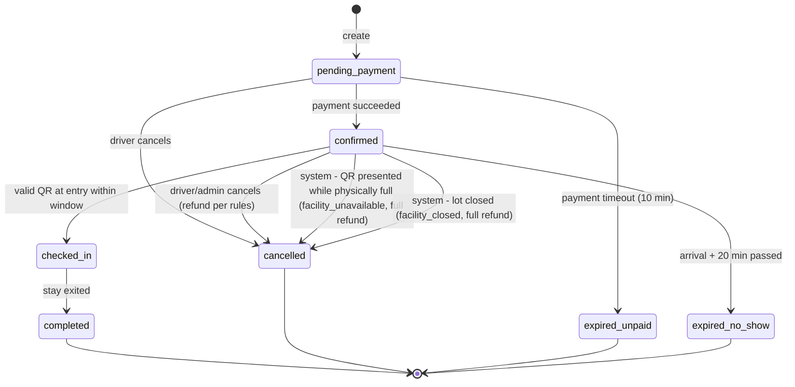
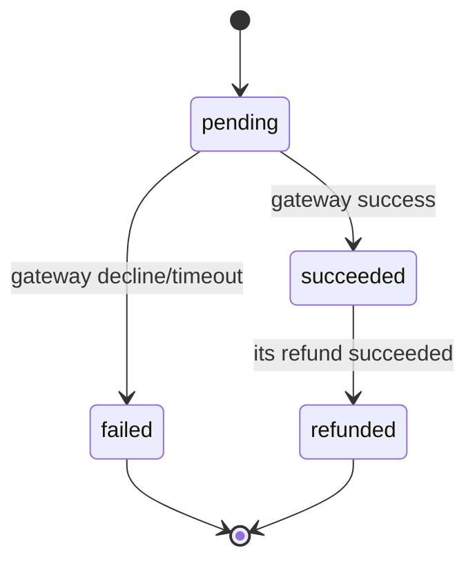
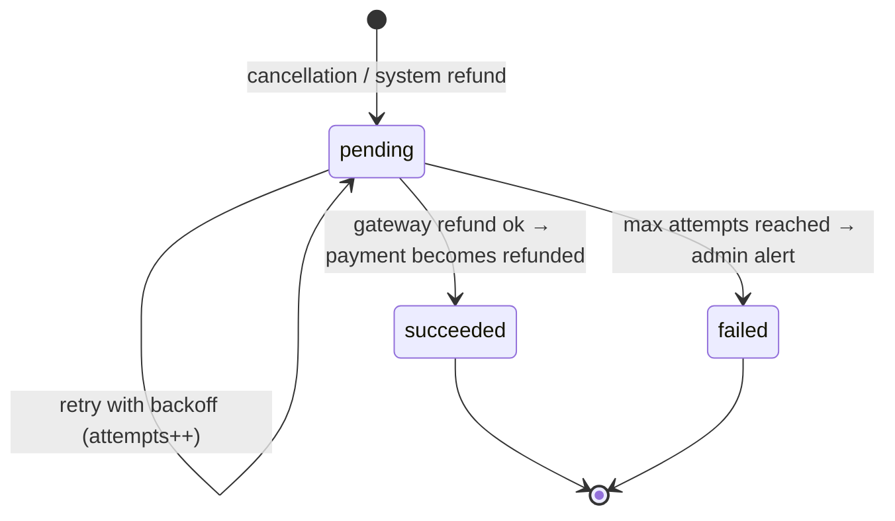
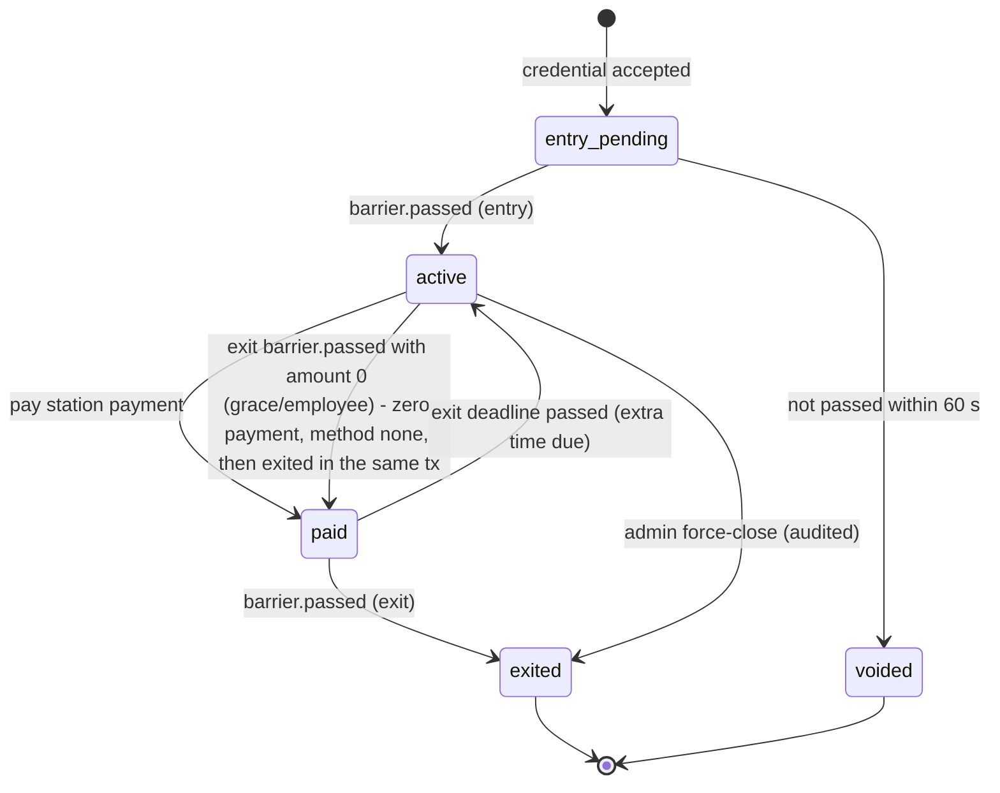

# MyPark — Project Specification

MyPark (branded "MyPark · Banreservas Zona Colonial") is a real-time parking availability and reservation platform for the 280-space Banreservas parking facility at Calle Arzobispo Meriño No. 386, Zona Colonial, Santo Domingo. Drivers can check live availability before leaving, see rates, hours and location, and reserve a guaranteed spot for a fee. Administrators get live occupancy, reservation management, configurable tariffs and demand analytics. In Phase 1, a simulator stands in for the facility's physical devices (podium, ticket dispenser, barriers, pay station, space sensors, employee cards).

> **How to read this document.** Section 1 explains *what and why*. Sections 2–6 are the *requirements contract*. Sections 7–8 give the *delivery plan*: phases and Phase 1 milestones. Decisions the product owner did not state explicitly are tagged **(our call)** and collected in §10. Companion docs: [`architecture.md`](./architecture.md) and [`policies.md`](./policies.md).

---

## 1. Project definition

### 1.1 Context (current system)

| Aspect | Today |
|---|---|
| Facility | ~280 spaces, open 24/7, used by employees, bank customers and Zona Colonial visitors |
| Entry | A digital podium detects the vehicle, a dispenser issues a paper ticket with a QR code, and employees enter with an access card |
| Occupancy | Tracked internally by the access system; the entry gate is closed when the lot is full |
| Payment | Cash at a pay station: scan the ticket QR, the system computes time-based fees, and the ticket is validated at the exit barrier |
| Gap | **Drivers cannot see availability remotely.** They must drive there to find out |

### 1.2 Problem (from the user survey and staff interview)

- Most respondents have had trouble finding parking in the Zona Colonial, and **90.5%** have arrived to find this lot full.
- Searching takes **5–20+ minutes**. When the lot is full, more than 70% look for another lot or leave the area.
- **95.2%** consider knowing availability in advance useful or very useful. No respondent has ever used an app for this.
- What drivers want to see, in priority order: available spaces count, open/full status, then location, rates and hours.
- Demand peaks on weekends and holidays.

### 1.3 Goals

| # | Goal | Measured by |
|---|---|---|
| G1 | Drivers see accurate, live availability before leaving | Availability shown within 2 s of a gate event (NFR-PERF-1) |
| G2 | Drivers can reserve a guaranteed spot | A confirmed reservation is never denied entry within its window because drive-ups took the spots (FR-RES-6) |
| G3 | Staff get exact, real-time control of free, occupied and reserved capacity | Live admin dashboard; gate vs sensor reconciliation |
| G4 | The data collected identifies demand peaks | Occupancy history and hour × weekday heatmap |
| G5 | Phase 1 is a convincing academic demo built to production standards | All Phase 1 milestones met by **2026-12-18** |

### 1.4 Non-goals (Phase 1)

- Low-level device integration (C/C++, serial, PLC, vendor SDKs). Devices are **simulated** behind the same API that real hardware will use later.
- Real payment processing. The gateway is **simulated** behind a port so a real provider can be plugged in later.
- Cameras, DVR and video streaming (placeholder panel only).
- Online payment of hourly parking fees. Hourly fees are paid at the simulated pay station **(our call)**.
- Multiple lots, dynamic pricing and demand forecasting (later phases). The schema is lot-aware from day one **(our call)**.
- Push notifications (Phase 2). Phase 1 uses email plus in-app messages.
- Cloud deployment. Phase 1 runs on local Docker Compose, kept ready for a VPS.

### 1.5 Anti-goals (failure even if it "works")

- A reserved driver arrives within the window and the lot is full because of drive-ups.
- Two concurrent requests push reservations past the reservable cap.
- The availability shown to the public drifts from the real gate count without anyone noticing.
- Charging a reservation fee twice, or a refund that is lost or duplicated.
- Hardcoded Spanish or English strings, so the second language becomes an afterthought.
- Using the Banreservas brand outside the agreed academic/demo scope, or in production without written authorization (see `policies.md` §1.9).

---

## 2. Actors and roles

| Actor | Kind | Channels | Description |
|---|---|---|---|
| **Driver** | App role `driver` | Web (driver area), mobile app | Registers, manages vehicles, checks availability, reserves, pays the reservation fee, presents the QR code |
| **Admin** | App role `admin` | Web (admin area) | Monitors occupancy, manages reservations, tariffs, policies, devices, employee cards and users; views analytics; runs the simulator console |
| **Employee card holder** | Credential, **not** an app role | Physical card (simulated) | A facility employee. Counts toward capacity and parks for free (RD$0). May also hold a driver account |
| **Anonymous visitor** | No account | Web, mobile | Can view availability, rates, hours and location without logging in **(our call)** |
| **Device** | System actor | Device API (HMAC-signed) | Podium, ticket dispenser, entry/exit barriers, pay station and sensor gateway. All simulated in Phase 1 |
| **Worker** | System actor | Internal | Expires no-shows and unpaid holds, takes occupancy snapshots, sends email, processes refunds |

---

## 3. Functional requirements

Requirement IDs are stable; tests and PRs reference them. **Must** means Phase 1 scope.

### 3.1 FR-AUTH — Accounts and authentication

| ID | Requirement |
|---|---|
| FR-AUTH-1 | A driver registers with first name, last name, email, phone (optional) and password. The account starts as `pending_verification` |
| FR-AUTH-2 | The system emails a 6-digit verification code (15-minute expiry, max 5 attempts). Verifying sets the account to `active` **(our call)** |
| FR-AUTH-3 | Login uses email + password. Unverified accounts are asked to verify first |
| FR-AUTH-4 | Sessions: web uses httpOnly cookies via the BFF; mobile uses a short-lived access token plus a rotating refresh token stored in secure storage (see architecture §5) |
| FR-AUTH-5 | Password reset via an emailed code. A reset revokes all sessions |
| FR-AUTH-6 | Logout revokes the current session. "Log out everywhere" revokes all sessions |
| FR-AUTH-7 | Admin accounts are never self-registered. The first admin is created by `cmd/seed`, and later admins by an existing admin **(our call)** |
| FR-AUTH-8 | Repeated failed logins are rate-limited (see policies §2.7) |
| FR-AUTH-9 | A driver can update their profile and preferred language, and delete their account (soft delete + anonymization, policies §1.8) |
| FR-AUTH-10 | Registration requires accepting the current terms and privacy notice. The accepted versions and timestamps are stored on the user. When a new version is published, the user is asked to accept it at next login **(our call)** |

**Scenario — refresh token reuse**
- **Given** a mobile session whose refresh token R1 was already rotated to R2
- **When** a client presents R1 again
- **Then** the whole token family is revoked, the request gets `401 auth.session_revoked`, and an audit entry is written.

### 3.2 FR-VEH — Vehicles

| ID | Requirement |
|---|---|
| FR-VEH-1 | A driver can add, edit and remove vehicles (plate, make, model, color) |
| FR-VEH-2 | Plates are normalized (uppercase, no spaces or dashes) for uniqueness. The display form is kept as entered |
| FR-VEH-3 | A plate can be active on at most one account. A conflict returns `vehicle.plate_taken` **(our call)** |
| FR-VEH-4 | A vehicle with a `confirmed` or `checked_in` reservation cannot be removed |
| FR-VEH-5 | A driver can have up to 5 vehicles **(our call, configurable)** |

### 3.3 FR-AVAIL — Live availability and lot information

| ID | Requirement |
|---|---|
| FR-AVAIL-1 | Anyone can see the lot's available spaces, status (`open` / `full` / `closed`), last update time, address with a map link, opening hours and current rates |
| FR-AVAIL-2 | Availability is pushed live (SSE). No manual refresh is needed |
| FR-AVAIL-3 | **Public available** = `effective_capacity − occupied − effective_holds` (definitions in §5.2), floored at 0 |
| FR-AVAIL-4 | Status is `full` when public available = 0, and `closed` when an admin closes the lot |
| FR-AVAIL-5 | The server sends a heartbeat every 15 s, and any event or heartbeat counts as fresh. Clients show the last known value with a "stale — last updated hh:mm" indicator when the connection drops or nothing arrives for **45 s**, and reconnect with backoff **(our call)** |
| FR-AVAIL-6 | The availability view also shows how many reservations are upcoming in the next 2 hours, as a count only **(our call)** |

**Scenario — live update**
- **Given** a driver viewing availability with 12 spaces available
- **When** the simulated entry barrier reports a vehicle passing
- **Then** within 2 seconds the driver sees 11 without refreshing.

### 3.4 FR-RES — Reservations (pool-based)

| ID | Requirement |
|---|---|
| FR-RES-1 | A verified driver picks a registered vehicle and a booked arrival time from now (rounded up to the next 5 minutes) up to **7 days** ahead, and sees the flat fee before confirming |
| FR-RES-2 | A reservation holds **a spot from the pool**, never a specific space |
| FR-RES-3 | A driver can have at most **1 active reservation** (`pending_payment` or `confirmed`) |
| FR-RES-4 | Reservable cap: the number of reservations whose hold windows overlap must never exceed `floor(30% × effective_capacity)` (84 of 280 with every space in service). The check is enforced atomically (architecture §7). The cap is recomputed when spaces go out of or back into service. Confirmed reservations are **never** auto-cancelled by a cap change. Any overflow is handled by FR-GATE-2 **(our call)** |
| FR-RES-5 | Creating a reservation sets it to `pending_payment` and starts the fee payment. Unpaid reservations expire after **10 minutes** and release their hold **(our call)** |
| FR-RES-6 | **Guarantee:** while a confirmed reservation's hold is effective, it is subtracted from public availability, and drive-up entry is denied once public available reaches 0 (§5.2) |
| FR-RES-7 | When payment succeeds, the status becomes `confirmed` and the app shows a QR code holding an opaque signed token. The QR is available offline once loaded |
| FR-RES-8 | At the entry barrier, a valid QR inside its window (`arrival − 15 min` to `arrival + 20 min`) opens the barrier, sets the status to `checked_in` and starts a stay |
| FR-RES-9 | A QR presented too early is denied with `reservation.too_early`. The driver can still enter as a drive-up if there is room |
| FR-RES-10 | If not checked in by `arrival + 20 min`, the worker marks it `expired_no_show` and releases the hold. The fee is forfeited |
| FR-RES-11 | A driver can cancel a `confirmed` reservation. **Before** the booked arrival time the fee is fully refunded; at or after it, no refund |
| FR-RES-12 | Drivers see active and past reservations with status, fee, refund status and stay summary |
| FR-RES-13 | For an arrival less than 15 minutes away, the reservation is only allowed if public available ≥ 1 right now **(our call)** |
| FR-RES-14 | Reservations can be made for any time **24/7**, because the lot operates 24/7 **(our call)**. They are not allowed while the lot is `closed` |
| FR-RES-15 | If an admin closes the lot, every confirmed reservation whose hold window overlaps the closure is cancelled by the system (`refund_reason = facility_closed`) with a full refund and an email **(our call)** |
| FR-RES-16 | A driver can change the vehicle on a `confirmed` reservation until the booked arrival time (`PATCH /v1/reservations/{id}`). Fee and window stay the same **(our call)** |
| FR-RES-17 | No-show block: `noshow_block_threshold` (3) no-shows within `noshow_window_days` (30) block new reservations for `noshow_block_days` (7). The values are configurable in policy versions, and blocked attempts return `reservation.blocked_no_shows` with the unblock date **(our call)** |
| FR-RES-18 | The tariff version and policy version in effect at booking are captured on the reservation, and the resulting stay inherits that tariff version **(our call)** |

**Scenario — cap is atomic**
- **Given** 83 reservations whose hold windows overlap 10:00–10:35
- **When** two drivers submit reservations for 10:10 at the same instant
- **Then** exactly one succeeds and the other gets `409 reservation.capacity_reached`.

**Scenario — guarantee against drive-ups**
- **Given** capacity 280, occupied 279, and one confirmed reservation with arrival 10:00 (hold effective from 09:45)
- **When** a drive-up asks for a ticket at 09:50
- **Then** the dispenser denies entry (`gate.lot_full`) and public availability shows 0.
- **And when** the reserved driver presents the QR at 09:55, the barrier opens.

**Scenario — refund rules**
- **Given** a confirmed reservation for 15:00
- **When** the driver cancels at 14:59 → status `cancelled`, a RD$150 refund is issued
- **When** the driver cancels at 15:05 → status `cancelled`, no refund (`refund_reason = none_after_arrival`)
- **When** the driver never shows up → at 15:20 the status becomes `expired_no_show` and the fee is forfeited.

### 3.5 FR-PAY — Payments (simulated gateway)

| ID | Requirement |
|---|---|
| FR-PAY-1 | The reservation fee (RD$150, flat, upfront) is charged through the `PaymentGateway` port. Phase 1 uses the simulated adapter |
| FR-PAY-2 | Every charge and refund carries an idempotency key, so retries never double-charge |
| FR-PAY-3 | The simulated gateway takes test card numbers that decide the outcome (success, decline, timeout) so failure paths can be demoed **(our call)** |
| FR-PAY-4 | A failed charge leaves the reservation `pending_payment`. The driver can retry until it expires |
| FR-PAY-5 | Refunds are processed asynchronously by the worker and retried with backoff until they succeed |
| FR-PAY-6 | Hourly parking fees are paid at the simulated pay station (cash) and recorded as `parking_fee` payments with method `cash` |
| FR-PAY-7 | The reservation fee is **not** credited toward hourly charges |
| FR-PAY-8 | Drivers can see receipts (amount, date, method, status) for their payments |
| FR-PAY-9 | No raw card data is stored. Only the provider reference, last four digits and brand are kept (a simulated token in Phase 1) |

### 3.6 FR-GATE — Entry, exit and pay-station flows

| ID | Requirement |
|---|---|
| FR-GATE-1 | **Drive-up entry:** the podium detects a vehicle, the dispenser asks the API, and the API issues a ticket if public available > 0, otherwise denies with `gate.lot_full` |
| FR-GATE-2 | **Reservation entry:** the QR is validated as in FR-RES-8. It skips the public-availability check because its hold is already netted out, but under the `lot_occupancy` lock it still requires `active stays < effective_capacity`, so occupancy never goes above effective capacity. If the lot is physically full, the gate denies with `gate.lot_physically_full`, and the system cancels the reservation (`confirmed → cancelled`, `refund_reason = facility_unavailable`), queues a full refund and opens an incident alert **(our call)** |
| FR-GATE-3 | **Employee entry:** an active employee card opens the barrier if public available > 0. The stay is marked as an employee stay (RD$0) |
| FR-GATE-4 | Occupancy changes **only** when the barrier reports the vehicle passed (`barrier.passed`), not when a credential is accepted. An entry accepted but not passed within 60 s is voided **(our call)** |
| FR-GATE-5 | **Pay station:** scanning a ticket or reservation QR returns the amount due per §5.1. A simulated cash payment marks the stay `paid` and sets `exit_deadline = paid_at + 15 min` |
| FR-GATE-6 | **Exit:** the barrier opens for a stay that is `paid` and within its exit deadline. If the amount due is 0 (exit grace or employee stay), the barrier opens. On the exit `barrier.passed`, one transaction records a zero payment (`amount 0`, method `none`) and moves the stay `active → paid → exited` **(our call)**. Otherwise it denies with `gate.payment_required` |
| FR-GATE-7 | After the exit deadline passes, the extra time since payment is billed using the same tariff rules (minimum one additional-hour unit) **(our call)** |
| FR-GATE-8 | **Lost ticket:** an admin or the pay station can mark a stay as lost and charge the lost-ticket fee (§5.1) |
| FR-GATE-9 | Every device request is authenticated (HMAC), idempotent (event id) and logged in `device_events` |
| FR-GATE-10 | A gate denial returns a reason code that the simulator and admin console display |

### 3.7 FR-SIM — Device simulator

| ID | Requirement |
|---|---|
| FR-SIM-1 | A Go service (`apps/server/cmd/simulator`) acts as the podium, dispenser, entry/exit barriers, pay station, 280 space sensors and employee cards |
| FR-SIM-2 | It uses **only** the public device API with per-device HMAC keys, exactly as real hardware would |
| FR-SIM-3 | Scenarios: `idle`, `weekday`, `weekend_peak`, `fill_to_full`, `reservation_arrivals`, `no_show`, `sensor_drift` (sensors disagree with gates). Each has a speed factor for how often events fire |
| FR-SIM-4 | Each simulated car has a lifecycle: arrive → (ticket / QR / card) → pass → occupy a random free space (sensor) → dwell (scenario distribution) → pay → exit → free the space |
| FR-SIM-5 | A control HTTP API (internal network only) lets you start/stop scenarios, inject a single car, present a specific reservation QR, present an employee card, mark a ticket lost and toggle a sensor fault |
| FR-SIM-6 | The admin web has a **Simulator console** that calls the control API through the BFF |
| FR-SIM-7 | The simulator is deterministic when given a seed, so demos and tests are reproducible |

### 3.8 FR-ADMIN — Administration

| ID | Requirement |
|---|---|
| FR-ADMIN-1 | **Dashboard** (based on the student mockup): KPI cards for total, available, occupied and active reservations; a per-space lot map (free / occupied / out of service) with a reserved-count badge; recent reservations; an occupancy history chart; system status (API, worker, simulator heartbeat, last event latency); and a cameras panel placeholder marked "Phase 2" |
| FR-ADMIN-2 | **Reservations:** search and filter by status, date or plate; view details and timeline; cancel with a refund override (reason required and audited) |
| FR-ADMIN-3 | **Stays:** list active stays, view details, mark a ticket lost, force-close a stay (reason required and audited) |
| FR-ADMIN-4 | **Tariffs and policies:** edit all values in §5.1 and §5.3. Each save creates a new version with an effective-from time. History is kept, and running stays and reservations keep the version they started with |
| FR-ADMIN-5 | **Lot:** edit name, address, coordinates and hours; open/close the lot; mark spaces out of service (reduces effective capacity) |
| FR-ADMIN-6 | **Devices:** list devices with last-seen time; create a device; rotate its key (the secret is shown once); disable it |
| FR-ADMIN-7 | **Employee cards:** register, revoke and list cards and their stays |
| FR-ADMIN-8 | **Users:** search drivers, view their reservations, suspend or reactivate; invite admins |
| FR-ADMIN-9 | **Reconciliation alerts:** show open discrepancies between the gate count and sensors, and stays that overran thresholds; resolve them with a note |
| FR-ADMIN-10 | **Audit log:** a read-only, filterable list of every admin action and security event |
| FR-ADMIN-11 | The admin dashboard updates live over SSE |

### 3.9 FR-ANALYTICS — Demand analytics

| ID | Requirement |
|---|---|
| FR-ANALYTICS-1 | The worker records an occupancy snapshot every **5 minutes** (occupied, available, effective holds, sensor-occupied) |
| FR-ANALYTICS-2 | Occupancy history chart (day / week / custom range) |
| FR-ANALYTICS-3 | Heatmap of average occupancy % by **hour of day × weekday** |
| FR-ANALYTICS-4 | Peak periods: the top N time slots with the highest average occupancy and the number of times the lot was full |
| FR-ANALYTICS-5 | Reservation metrics: created, confirmed, cancelled (with and without refund), no-show rate, fee revenue |
| FR-ANALYTICS-6 | Revenue summary by kind (reservation fees vs parking fees) and by credential type |
| FR-ANALYTICS-7 | CSV export for every analytics table |
| FR-ANALYTICS-8 | A seed command generates 8 weeks of plausible history so analytics are meaningful on demo day **(our call)** |

### 3.10 FR-I18N — Internationalization

| ID | Requirement |
|---|---|
| FR-I18N-1 | All UI is available in **Spanish (es-DO, default)** and **English (en)** |
| FR-I18N-2 | Language picks: the saved user preference, otherwise the device/browser locale, otherwise es-DO. Users can switch at any time |
| FR-I18N-3 | The API never returns user-facing prose. It returns stable error codes (e.g. `reservation.capacity_reached`) and the clients translate them |
| FR-I18N-4 | Currency is shown as `RD$` with es-DO number formatting. Dates and times are shown in `America/Santo_Domingo` |
| FR-I18N-5 | Emails are rendered in the recipient's preferred language |

### 3.11 FR-NOTIF — Notifications

| ID | Requirement |
|---|---|
| FR-NOTIF-1 | Emails: verification code, password reset, reservation confirmed (with QR), reminder **30 minutes** before arrival, cancellation + refund status, no-show expiry |
| FR-NOTIF-2 | Emails are sent through a transactional outbox (no lost or duplicated sends). In development they go to Mailpit |
| FR-NOTIF-3 | In-app: toasts for live events while the app is open (e.g. "your reservation window is open") |
| FR-NOTIF-4 | Push notifications are Phase 2 (Expo Notifications) |

### 3.12 FR-BRAND — Branding

| ID | Requirement |
|---|---|
| FR-BRAND-1 | Web and mobile use the **Banreservas** name, logo and brand colors (deep blue primary + orange accent, as in the student mockup) |
| FR-BRAND-2 | The product name is **MyPark**, shown as "MyPark · Banreservas Zona Colonial" in headers, the app name, page titles and emails |
| FR-BRAND-3 | Exact colors and logo files come from official brand assets supplied by the team. Until then, design tokens use placeholder values marked `TODO(brand)` and a text wordmark. No colors are sampled from the mockup image as final values |
| FR-BRAND-4 | Brand colors must still meet WCAG 2.2 AA contrast. Accessible shades are derived as tokens when an official color fails |
| FR-BRAND-5 | Brand use is limited to the academic/demo scope (`policies.md` §1.9) |

---

## 4. Non-functional requirements

| ID | Category | Requirement |
|---|---|---|
| NFR-PERF-1 | Freshness | From `barrier.passed` to an updated count on connected clients: p95 < **2 s** |
| NFR-PERF-2 | API latency | Read endpoints p95 < 200 ms, write endpoints p95 < 400 ms on the demo machine |
| NFR-PERF-3 | Scale | One API instance handles ≥ 500 concurrent SSE clients and ≥ 50 device events/s |
| NFR-AVAIL-1 | Resilience | Clients keep working with stale data when the API is unreachable. Device requests are idempotent so the simulator can retry safely |
| NFR-AVAIL-2 | Restart | All state lives in Postgres. Any container can restart without losing data or drifting the count |
| NFR-SEC-1 | Baseline | OWASP ASVS Level 1, details in `policies.md` §2.7 |
| NFR-SEC-2 | Transport | HTTPS everywhere outside local dev (Caddy edge when deployed) |
| NFR-SEC-3 | Data | Passwords hashed with argon2id. Tokens and codes stored only as hashes. Device secrets encrypted at rest |
| NFR-A11Y-1 | Accessibility | Web meets WCAG 2.2 AA. Mobile supports screen readers, dynamic type and 44 pt touch targets |
| NFR-I18N-1 | Language | No hardcoded user-facing strings in code (lint-enforced where possible) |
| NFR-OBS-1 | Observability | Structured JSON logs with request ID; `/healthz` and `/readyz` on every Go service |
| NFR-PORT-1 | Portability | `docker compose up` gives a working system on a clean machine. No cloud-only dependencies |
| NFR-PRIV-1 | Privacy | Collect only the data needed. Follow retention per `policies.md` §1.8 (Ley 172-13) |
| NFR-TEST-1 | Quality | Domain rules (tariffs, availability, reservation cap, state machines) have ≥ 90% branch coverage. CI must pass before merge |

---

## 5. Business rules

All values are **admin-configurable and versioned** (FR-ADMIN-4). The values below are the Phase 1 defaults. Money is stored as integer centavos (DOP).

### 5.1 Tariffs

| Rule | Default | Source |
|---|---|---|
| First hour (or any fraction of it) | **RD$50** | User |
| Each additional hour or fraction | **RD$25** | User-approved placeholder |
| Exit grace: total stay ≤ N minutes is free | **10 min** | User-approved placeholder |
| Post-payment exit window | **15 min** after payment | **(our call)** |
| Daily cap per rolling 24 h block from entry | **RD$400** | User-approved placeholder |
| Lost ticket fee | **RD$500** | User-approved placeholder |
| Reservation fee (flat, upfront, refundable before arrival) | **RD$150** | User-approved placeholder |
| Employee card stays | **RD$0** | User |

**Fee calculation (our call on the exact algorithm):**

```
duration = exit_or_scan_time − entered_at
if duration ≤ exit_grace:                   amount = 0
else:
  full_blocks = floor(duration / 24h)
  remainder   = duration − full_blocks × 24h
  block_fee(r) = (r == 0) ? 0 : min(daily_cap, first_hour + ceil(max(r − 1h, 0) / 1h) × additional_hour)
  amount = full_blocks × daily_cap + block_fee(remainder)
```

- For a reservation stay, `entered_at` is the check-in time.
- **Lost ticket (our call):** the lost-ticket fee **replaces** the time charge for the first 24 h block. Any further full or partial 24 h blocks (if entry time is known from device events) are charged normally.
- **Tariff version capture (our call):** a reservation captures the tariff version and policy version in effect **at booking**, so its fee, rules and hourly rates are fixed then, and the resulting stay inherits `reservations.tariff_version_id`. Drive-up and employee stays capture the version in effect **at entry**. A later tariff change never affects a running stay or a confirmed reservation.

### 5.2 Availability and the reservation guarantee

| Term | Definition |
|---|---|
| `capacity` | The lot's configured spaces (280) |
| `effective_capacity` | `capacity − spaces marked out_of_service` |
| `occupied` | Vehicles inside, by gate count: `barrier.passed` entries minus exits. **The authoritative count** |
| `hold window` | `[arrival − early_arrival, arrival + arrival_grace]` = `[arrival − 15 min, arrival + 20 min]` |
| `effective_holds` | Confirmed reservations whose hold window contains *now* and that have not yet checked in |
| `public available` | `max(0, effective_capacity − occupied − effective_holds)` |
| `sensor_occupied` | Spaces reported occupied by the sensors. Used for the map and reconciliation only, **never for gating** |

Rules:
1. Drive-up and employee entries are allowed only if `public available > 0`.
2. Reservation entries inside the hold window skip the public-availability check, because their spot is already in `effective_holds`. They are allowed whenever `active stays < effective_capacity`, re-checked under the `lot_occupancy` row lock, so `occupied` never goes above `effective_capacity` **(our call)**.
3. The reservable cap (§5.3) is `floor(max_reservable_pct × effective_capacity)` at any instant, so at least 70% always stays available to drive-ups. It is recomputed when spaces go out of or back into service. Existing confirmed reservations are never auto-cancelled by a cap change, and any overflow falls under rule 4 **(our call)**.
4. **Accepted limitation:** a hold only subtracts from availability once it becomes effective (15 min before arrival). If the lot is physically full of overstaying vehicles when a hold becomes effective, the reserved driver gets the **first** space that frees up, because drive-ups are denied while `public available = 0`. If the driver presents the QR while the lot is physically full (`active stays ≥ effective_capacity`), entry is denied with `gate.lot_physically_full`, and the system **immediately** cancels the reservation (`confirmed → cancelled`, `refund_reason = facility_unavailable`), queues a full refund and opens an incident alert **(our call)**.
5. For entry decisions, accepted-but-not-yet-passed entries (`entry_pending`) count as occupied, so two simultaneous acceptances can't both take the last space. The displayed `occupied` still changes only on `barrier.passed` **(our call)**.
6. Gate vs sensor discrepancy: if `|occupied − sensor_occupied| ≥ 3` for more than 10 minutes, the system raises a reconciliation alert **(our call)**.

### 5.3 Reservation policy

| Rule | Default | Source |
|---|---|---|
| Model | Pool-based, no specific space | User |
| Max reservable at any instant | **30% of effective capacity** (84 with all 280 in service) across overlapping hold windows | User-approved (effective-capacity basis: our call) |
| No-show block | 3 no-shows in 30 days → no new reservations for 7 days | **(our call)** |
| Lot closed after booking | System cancellation, full refund (`facility_closed`) | **(our call)** |
| Vehicle change | Allowed until the booked arrival time | **(our call)** |
| Booking horizon | **7 days** ahead | User-approved |
| Active reservations per driver | **1** | User-approved |
| Arrival grace (no-show cutoff) | **20 min** after booked arrival | User |
| Early arrival window | **15 min** before booked arrival | **(our call)** |
| Payment timeout for `pending_payment` | **10 min** | **(our call)** |
| Cancel before booked arrival | Full refund | User |
| Cancel at/after booked arrival | No refund | User ("before arrival" = before booked arrival time; our call on interpretation) |
| No-show | Fee forfeited | User |
| Facility unable to admit within window | Full refund | **(our call)** |
| Requires registered vehicle | Yes | **(our call)** |
| Employees reserving via the app | Pay the normal fee (the benefit applies to card stays only) | **(our call)** |
| Time slot granularity for cap accounting | 5 min | **(our call)** |
| Timezone for all rules | `America/Santo_Domingo` (UTC−4, no DST) | **(our call)** |

### 5.4 State machines

**Reservation**



**Payment** (row in `payments`)



**Refund** (separate row in `refunds`, linked to a succeeded payment) **(our call)**



**Stay**



---

## 6. Screens (Phase 1)

| Area | Web | Mobile |
|---|---|---|
| Public | Home with live availability, rates, hours, location; login; register; verify; reset | Same as web home; auth flow |
| Driver | Dashboard (availability + active reservation); Reserve flow; My reservations (+ QR); Vehicles; Payments/receipts; Profile & language | Tabs: Availability · Reserve · My reservations (QR) · Vehicles · Profile |
| Admin | Dashboard (mockup); Lot map; Reservations; Stays; Tariffs & policies; Lot settings; Devices; Employee cards; Users; Analytics; Reconciliation; Audit log; Simulator console | — |

---

## 7. Phases (product roadmap)

| Phase | Name | Scope | Exit |
|---|---|---|---|
| **1** | Academic MVP | Everything in §3 with simulated devices and gateway, a single lot, local Docker Compose | Demo on 2026-12-18 (§8) |
| **2** | Pilot | Real device adapters (podium, barriers, pay station, sensor gateway), a real payment provider, VPS deployment with TLS, push notifications, in-app payment of hourly fees, camera feeds (DVR integration), formal legal/privacy review | Running in the facility with real hardware for 4 weeks |
| **3** | Smart management | Dynamic pricing from demand analytics, occupancy forecasting, multiple lots, loyalty/subscriptions, public API for third-party maps | Business KPIs from the ROI analysis are tracked |

---

## 8. Phase 1 milestones

Timeline: **2026-11-09 → 2026-12-18** (6 weeks). Each milestone ends with a short demo. Driver features take priority, as the user requested.

| Milestone | Dates | Theme |
|---|---|---|
| M0 | Nov 9 – Nov 13 | Foundations |
| M1 | Nov 16 – Nov 20 | Auth + vehicles |
| M2 | Nov 23 – Nov 27 | Live availability + simulator + gate flows |
| M3 | Nov 30 – Dec 4 | Reservations + payments |
| M4 | Dec 7 – Dec 11 | Admin + analytics + tariff config |
| M5 | Dec 14 – Dec 18 | Hardening + demo |

### Team and parallel tracks

There are two developers, and each reviews the other's PRs (`policies.md` §2.2). Work runs in **two parallel tracks** **(our call)**:

| Track | Owner | Covers |
|---|---|---|
| **A — Backend + simulator** | Developer A | `apps/server` (API, worker, simulator, migrations), `api/openapi.yaml`, compose |
| **B — Web + mobile** | Developer B | `apps/web`, `apps/mobile`, design tokens, i18n messages |

**Contract-first handoff:** at the start of each milestone, Track A publishes the milestone's endpoints and error codes in `apps/server/api/openapi.yaml`. They are regenerated into `packages/contracts` and merged before implementation starts. Track B builds against those types (MSW mocks from the OpenAPI fixtures) while Track A implements, and the two tracks integrate by mid-week. Contract changes after the handoff need a PR that both developers approve.

| Milestone | Track A | Track B |
|---|---|---|
| M0 | Go scaffold, migrations baseline, compose, CI (Go) | Web + mobile scaffold, tokens, i18n, CI (JS), contracts pipeline |
| M1 | Auth, vehicles, outbox/email, audit, rate limits | Auth screens + BFF sessions (web), secure storage (mobile), vehicles UI |
| M2 | Device API, gate flows, occupancy, SSE, simulator + control API | Live availability (web/mobile), lot info, basic Simulator console |
| M3 | Reservations, cap, payment port, refunds, worker jobs | Reserve flow, payment UI, QR display, My reservations |
| M4 | Admin endpoints, analytics queries, tariff versions, reconciliation, history seed | Admin dashboard, analytics charts, settings screens |
| M5 | Security review, perf checks, scenario tests | Accessibility pass, Playwright e2e, EAS preview build, demo script |

### M0 — Foundations (ready-to-start detail)

**Scope**
0. Repository `github.com/XYZLZ/MyPark` with branch protection on `main` (required CI checks + 1 approval, no direct pushes). Go module path `github.com/XYZLZ/MyPark/apps/server`. A PR template with the security checklist (`policies.md` §2.2).
1. Monorepo scaffold per architecture §3: root `package.json` with npm workspaces (`apps/web`, `apps/mobile`, `packages/contracts`), `.gitignore`, `.editorconfig`, root `README.md`. No `.env` files are committed or required: compose uses inline `${VAR:-dev-default}` dev-only defaults.
2. `apps/server`: Go 1.27 module; `cmd/api`, `cmd/worker`, `cmd/migrate`, `cmd/simulator`, `cmd/seed` stubs; `internal/config` (env parsing with validation); slog JSON logger; request-ID middleware; `/healthz` + `/readyz` (DB ping); response/error envelope package.
3. Database: goose migration baseline (extensions `citext`, `btree_gist`; `lots` + `spaces` tables; roles `mypark_migrator` / `mypark_app` are created by the postgres init script `deploy/compose/postgres/init/01-roles.sh`, not by a migration), sqlc config, seed of the lot and 280 spaces.
4. `deploy/compose/docker-compose.yml`: `postgres:18`, `mailpit`, `api`, `worker`, `simulator`, `web` (mobile runs on the host with Expo). Healthchecks and named volumes.
5. `apps/web`: Next.js 16 + Tailwind 4 + TypeScript; route groups `(public)`, `(driver)`, `(admin)`; next-intl with `es-DO`/`en` message files; design tokens; vitest set up; a page showing API health.
6. `apps/mobile`: Expo SDK 58 + expo-router + Uniwind; `src/` layout per architecture §13; i18next + expo-localization; design tokens in `global.css` `@theme` (Banreservas brand placeholders, see FR-BRAND); an HTTP client pointing at the API; a screen showing API health.
7. `packages/contracts`: error code catalog + OpenAPI-generated TS types (pipeline only, generated from `apps/server/api/openapi.yaml`).
8. CI (`.github/workflows/ci-server.yml` job `server`; `.github/workflows/ci-js.yml` jobs `contracts`, `web`, `mobile`): Go vet/test/lint (golangci-lint), sqlc diff check, migrations up on an ephemeral Postgres, web lint/typecheck/test/build, mobile lint/typecheck/test, `npm ls react` single-version check, `npx expo install --check`.

**Exit criteria**
- [ ] `docker compose up` on a clean machine brings everything up healthy, and `GET /readyz` returns 200.
- [ ] Web and mobile both show "API: healthy" in es-DO and en.
- [ ] CI is green on `main`. A failing test blocks merge.
- [ ] Branch protection on `main` is active: required CI checks, 1 approval, no direct pushes (verified by a rejected direct push).
- [ ] The Go module builds as `github.com/XYZLZ/MyPark/apps/server`.
- [ ] Brand tokens exist with placeholder values marked `TODO(brand)`, and the header shows "MyPark · Banreservas Zona Colonial".
- [ ] `docs/` reflects any decisions changed during scaffolding.

**Demo:** clone → `docker compose up` → web at `localhost:3000`, mobile in Expo Go/dev client, Mailpit UI at `localhost:8025`.

### M1 — Auth + vehicles

**Scope:** FR-AUTH-1…10 (including terms/privacy acceptance), FR-VEH-1…5, the BFF session layer on web, secure token storage on mobile, the email outbox + Mailpit, the audit log table, rate limiting, and the first admin seed.
**Exit criteria** (backend verified on branch `feat/m1-backend`; items marked *needs Track B* are not complete until the web and mobile clients land)
- [ ] Register → verification email in Mailpit → verify → login on web **and** mobile. Backend verified: `TestM1BackendAcceptance` covers both `client_kind` values and Mailpit, and a compose smoke run confirmed it. *Needs Track B* for the web and mobile screens. Clients implemented on `feat/m1-clients`; pending the demo run in `docs/m1-demo-script.md`.
- [x] Refresh rotation + reuse detection covered by integration tests (`TestRefresh_ReuseRevokesFamily`, `TestRefresh_ConcurrentSameToken`, `TestRefresh_ReuseRevocationSurvivesErrorResponse`).
- [ ] Vehicle CRUD with plate uniqueness. All errors shown in both languages. Backend verified: vehicle integration tests, and every returned code is in `errcodes` and the generated contract. *Needs Track B* for the translated messages and the vehicles UI. Clients implemented on `feat/m1-clients`; pending the demo run in `docs/m1-demo-script.md`.
- [ ] An admin can log into the admin area. A driver cannot (403). Backend verified: `TestAuthzMatrix` and the acceptance test (seeded admin 200, driver 403 `auth.forbidden`). *Needs Track B* for the admin area itself. Clients implemented on `feat/m1-clients`; pending the demo run in `docs/m1-demo-script.md`.
**Demo:** create an account on mobile, add a car, log in on web with the same account.

### M2 — Live availability + simulator + gate flows

**Scope:** FR-AVAIL-1…6, FR-GATE-1…10, FR-SIM-1…7, the device registry with HMAC keys, `device_events`, the occupancy counter, the SSE stream (LISTEN/NOTIFY fan-out), the per-space sensor map, the pay-station fee calculation (§5.1), and a basic Simulator console.
**Exit criteria**
- [ ] The `weekday` scenario runs and availability on web and mobile updates in < 2 s.
- [ ] `fill_to_full` reaches 0 and the dispenser denies with `gate.lot_full`.
- [ ] The tariff calculator passes a table-driven test suite (grace, cap, multi-day, lost ticket).
- [ ] A replayed device event (same id) is a no-op. A bad signature returns 401.
**Demo:** start `weekday` from the console and watch the count and lot map move live; pay and exit a car.

### M3 — Reservations + payments

**Scope:** FR-RES-1…18 (including the lot-closed refund, vehicle change, no-show block and version capture), FR-PAY-1…9, the refunds table and worker, the cap accounting (slot loads), QR tokens, the worker jobs (unpaid expiry, no-show expiry, refunds, reminders), and reservation emails.
**Exit criteria**
- [ ] A concurrency test: 200 parallel reservation attempts never exceed the cap.
- [ ] Guarantee scenario (§3.4) passes end-to-end with the simulator.
- [ ] Cancel before arrival → refund `refunded`; cancel after → no refund; no-show → `expired_no_show`.
- [ ] Simulated decline/timeout paths work and are visible in the UI.
- [ ] A QR presented while physically full → `gate.lot_physically_full`, the reservation is cancelled and the refund succeeds.
- [ ] Closing the lot refunds overlapping reservations. After 3 no-shows in 30 days, a new reservation is rejected with `reservation.blocked_no_shows`.
**Demo:** reserve on mobile → pay → show QR → the simulator presents it → the barrier opens → the stay is billed hourly at exit.

### M4 — Admin + analytics + tariff config

**Scope:** FR-ADMIN-1…11, FR-ANALYTICS-1…8, versioned tariffs/policies, employee cards, reconciliation alerts, CSV export, the 8-week history seed.
**Exit criteria**
- [ ] The dashboard matches the mockup layout with live data (cameras = placeholder).
- [ ] Changing the tariff creates a new version. Running stays keep their old version (test).
- [ ] The heatmap and peak periods render from seeded history.
- [ ] The `sensor_drift` scenario raises a reconciliation alert.
**Demo:** a staff walkthrough of "today" (live ops) and "tomorrow" (analytics, pricing levers).

### M5 — Hardening + demo

**Scope:** accessibility pass (WCAG 2.2 AA audit on web, screen-reader pass on mobile), security review against ASVS L1, Playwright e2e for the critical driver flows, performance check (NFR-PERF-1/3), error/empty/loading states, a demo script with seeded data, an EAS preview build (Android APK), a VPS-readiness checklist (Caddy config drafted, not deployed).
**Exit criteria**
- [ ] All Phase 1 FRs are traced to at least one passing test or a demo-script step.
- [ ] No open critical/high findings.
- [ ] The demo script runs start to finish twice without manual DB edits.
**Demo:** the final presentation (2026-12-18).

---

## 9. Glossary

| Term | Meaning |
|---|---|
| Lot | A parking facility (Phase 1: one) |
| Space | A physical parking spot with a sensor |
| Stay | One vehicle's visit from entry to exit |
| Hold | A pooled spot reserved for a confirmed reservation during its hold window |
| Hold window | `[arrival − 15 min, arrival + 20 min]` |
| Effective hold | A hold whose window contains now and that hasn't checked in |
| Public available | Spaces shown as available to drive-ups (§5.2) |
| Drive-up | A driver entering without a reservation (paper ticket) |
| Credential | What opens the entry barrier: ticket, reservation QR or employee card |
| Device | A podium, dispenser, barrier, pay station or sensor gateway (simulated in Phase 1) |
| Reconciliation alert | A flagged mismatch between the gate count and sensors, or an anomalous stay |
| Tariff/policy version | An immutable snapshot of configurable rules with an effective-from time |

---

## 10. Decision register

### 10.1 Decided by the product owner

Simulator instead of hardware (no C/C++); pool-based reservations; 20-min arrival grace; flat upfront reservation fee, refundable if cancelled before arrival, forfeited on no-show; simulated gateway designed for a real swap; web for admin + drivers, mobile for drivers; plain Postgres with Go owning auth and real time; ~6-week deadline with the full driver experience + admin; ES + EN; **two developers who review each other's PRs**; repository `github.com/XYZLZ/MyPark` with protected `main` (required CI + 1 approval, no direct pushes); **Banreservas branding** (name, logo, brand colors; product name "MyPark", shown as "MyPark · Banreservas Zona Colonial"); employees count toward capacity and pay nothing; first hour RD$50; placeholder tariffs approved and configurable; 30% / 7 days / 1 active; local Compose now, VPS-ready later; npm (not pnpm); Go, Next.js + Tailwind, Expo + Uniwind (latest); Go 1.27; server config through accessors + `go-playground/validator/v10`; `expo/fetch` as the mobile HTTP transport; no `.env` files in the repo (owner permission constraint).

### 10.2 Our calls (review these)

1. Email verification by 6-digit code; admins created only by seed or invite.
2. Anonymous visitors can see availability without an account.
3. A plate is active on at most one account; max 5 vehicles per driver.
4. Hourly fees are paid at the simulated pay station only (online payment in Phase 2).
5. Post-payment exit window 15 min; extra time is billed afterwards.
6. Exact fee algorithm with rolling 24 h blocks (§5.1).
7. The lost-ticket fee replaces the first 24 h time charge.
8. Early arrival window 15 min; payment timeout 10 min; slot granularity 5 min.
9. "Before arrival" means before the booked arrival time.
10. Same-time reservations (< 15 min away) need current availability ≥ 1.
11. A reserved driver may enter while `active stays < effective_capacity` (re-checked under lock). If they present the QR while the lot is physically full: `gate.lot_physically_full`, immediate system cancellation (`facility_unavailable`), full refund, incident alert.
12. A sensor/gate discrepancy of ≥ 3 for 10 min raises an alert. Sensors never gate.
13. An entry not passed within 60 s is voided.
14. Employees who reserve through the app pay the normal fee.
15. Single lot in Phase 1 with a lot-aware schema.
16. Cameras are a placeholder only. Push notifications in Phase 2. 8-week analytics seed.
17. Language split: project docs in English, UI bilingual es-DO/en.
18. Test card numbers drive simulated gateway outcomes.
19. Reminder email 30 min before arrival.
20. Zero-due exit (grace/employee): on exit `barrier.passed`, one transaction records a zero payment (method `none`) and moves the stay `active → paid → exited`.
21. The tariff and policy versions are captured at booking for reservations, and the stay inherits the tariff version. Drive-up and employee stays capture the version at entry.
22. Refunds live in a separate `refunds` table (`pending/succeeded/failed`, attempts, reason). The payment moves `succeeded → refunded` when its refund succeeds.
23. Terms/privacy acceptance stored as version + timestamp on users (FR-AUTH-10, M1).
24. Lot closed after booking → system cancellation with a full refund (`facility_closed`) (FR-RES-15, M3).
25. Reservable cap = `floor(pct × effective_capacity)`, recomputed on space status changes. Confirmed reservations are never auto-cancelled by a cap change.
26. The vehicle on a confirmed reservation can be changed until the booked arrival time (FR-RES-16, M3).
27. No-show block: 3 in 30 days → blocked 7 days, configurable on policy versions (FR-RES-17, M3).
28. Data retention periods per `policies.md` §1.8.
29. Availability freshness: 15 s heartbeats. "Stale" after a dropped connection or 45 s without any event or heartbeat.
30. Pending (accepted, not yet passed) entries count as occupied for gate decisions (§5.2 rule 5).
31. Reservations are available 24/7 (FR-RES-14).
32. Two parallel tracks (A backend+simulator, B web+mobile) with contract-first OpenAPI handoffs (§8).
33. Sensitive PRs get a security checklist + automated risk review instead of a second human review (`policies.md` §2.2).
34. Architecture-level calls (Postgres 18, BFF cookies, SSE + LISTEN/NOTIFY, slot-load cap, OpenAPI contract, stdlib router, TanStack Query, next-intl/i18next) are listed in `architecture.md` §1 and §17.
35. TypeScript 6.0.3 in every JS workspace, pinned by Expo SDK 58.
36. M1 backend calls OC-1 to OC-39 are accepted as listed in the M1 backend design (`docs/superpowers/specs/2026-11-07-m1-backend-auth-vehicles-design.md` §2.2), including the "Changes during implementation" table at its top.
37. Gaps resolved while building M1: a second logout with a revoked session returns 401 and clients treat it as success; refresh for a suspended or pending user returns 401 without a write, and a deleted user's session is revoked with `account_deleted`; `DELETE /v1/me` is limited to 5 per 15 min per user (fails closed); the seed admin takes `SEED_ADMIN_FIRST_NAME` and `SEED_ADMIN_LAST_NAME`; vehicle CRUD is not audited in M1.
38. M1 client calls CC-1 to CC-27 are accepted as listed in the M1 clients design (`docs/superpowers/specs/2026-11-08-m1-clients-auth-vehicles-design.md` §2.2).

### 10.3 Open questions

None at this time. New questions are added here with a default to use if unanswered.

### 10.4 Pending inputs

| Input | Owner | Needed by |
|---|---|---|
| Official Banreservas brand assets (logo files, exact hex values) | Team | M4 (placeholders until then) |
